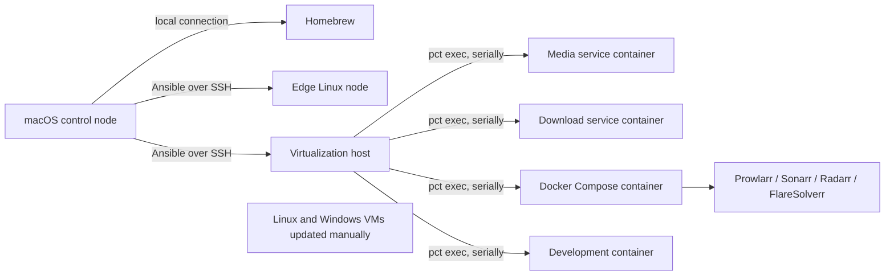

# homelab-ansible

`homelab-ansible` is a safety-first automation project for inspecting and
maintaining a mixed homelab from one macOS control machine. It turns
an error-prone sequence of SSH sessions and package commands into a reviewable,
repeatable workflow with explicit boundaries.

> `update-check` is read-only. Every apply entrypoint performs a read-only
> preflight, prints its plan, and requires the user to type `APPLY` before any
> update command can run.

## The problem

A homelab often combines Debian containers, a small edge computer, Docker
Compose workloads, a hypervisor, macOS tooling, and machines that must not be
treated like Linux. Updating all of them manually makes it easy to miss a host,
hide a failure in terminal output, or reboot a critical system at the wrong time.

This project provides a single control point while preserving deliberate human
decisions around high-risk operations. Ansible was selected because its
inventory model describes heterogeneous systems well, its modules encourage
idempotent operations, and its checkable YAML makes infrastructure decisions
suitable for code review.

## Architecture

The public architecture deliberately uses generic names and contains no home
network addresses.



The apply workflow updates configured LXC containers serially through Proxmox,
then handles the selected Raspberry Pi, regular Proxmox packages, and local
Homebrew. Reboot requirements are only reported; nothing is rebooted.

## Check mode and apply mode

`./bin/update-check` is a read-only discovery workflow:

- verifies SSH reachability before inspecting a Linux host;
- runs `apt-get --simulate upgrade`, which calculates regular package updates
  without installing anything or changing repositories;
- checks the existing `/var/run/reboot-required` marker;
- runs `brew outdated` locally with Homebrew auto-update disabled;
- processes Linux hosts one at a time and leaves failures visible in output and
  the Ansible recap.

`./bin/update-all` first validates external configuration, SSH reachability,
LXC state, simulated APT upgrades, and available Homebrew updates. If preflight
passes, it displays the plan and asks for the exact confirmation `APPLY`.

During apply it uses only `apt-get update` and regular `apt-get upgrade`.
Configured LXC containers are processed one at a time with `pct exec`; a stopped
container is `SKIPPED`, while a failure is recorded and processing continues.
Configured Docker Compose projects are then processed serially. LXC projects
run through Proxmox with `pct exec`; projects assigned directly to a managed
Linux inventory host run through that host's SSH connection. The workflow runs
`pull` followed by `up -d`.
Local Homebrew is updated with `brew update`, `brew upgrade -y`,
`brew upgrade --cask -y`, and `brew cleanup`, in that order.
Missing prerequisites are `SKIPPED`; an actual pull or up failure is `FAILED`.
After `up -d`, every Compose container must be running and either healthy or
without a health status. Exited, dead, restarting, and unhealthy states fail
that project without stopping later projects. Configured HTTP/HTTPS and TCP
checks run afterward from the control node and preserve partial results.
The final table is always printed. Any `FAILED` result makes the command exit
non-zero after the report. A sanitized JSON report is also written with mode
`0600` beneath the Git-ignored `reports/` directory.

## Safety decisions

- All Linux and Windows VMs are outside the automated workflow and are updated
  manually.
- The default Linux pattern is
  `linux_managed:lxc:!proxmox:!windows`; `lxc` keeps simple inventories
  compatible while the explicit exclusions preserve the safety boundary.
- No playbook performs a reboot, distribution upgrade, repository edit, volume
  removal, image prune, or other destructive Docker operation.
- LXC updates are serialized, and Raspberry Pi hosts use `serial: 1`.
- Host connectivity is checked first; an unavailable host is reported clearly.
- `any_errors_fatal: false` allows other hosts to be inspected while Ansible's
  final recap retains failures.
- Host key checking is enabled in the example configuration.
- Tasks that eventually accept sensitive values must use task-level
  `no_log: true`; ordinary task output remains visible so failures cannot hide.
- CI uses documentation fixtures plus a disposable Linux test container. It has
  no credentials, home-network route, Docker socket inside the test container,
  or self-hosted runner.

## Repository layout

```text
bin/                       small command wrappers
inventory/                 public example; real inventory stays external
examples/                  public example of non-secret local variables
playbooks/                 orchestration entry points
roles/                     connectivity, check, and controlled apply operations
tests/                     offline, regression, Compose, health, and report tests
reports/                   local JSON run reports; always ignored by Git
.github/workflows/         lint and syntax CI on GitHub-hosted runners
```

## Local configuration

Runtime configuration is intentionally not stored inside this source checkout,
even as an ignored working file. The wrapper reads these external paths:

```text
~/.config/homelab-ansible/
├── inventory.yml
└── group_vars/
    └── local.yml
```

`HOMELAB_CONFIG_DIR` can replace the directory root. The public source repo and
this private runtime configuration have separate lifecycles: chezmoi may manage
the latter, but must not manage the `homelab-ansible` source repository itself.

Prerequisites on the macOS control node:

- Python 3 and Ansible Core;
- Homebrew, if local package reporting is wanted;
- local SSH-agent access to existing keys; keys are not stored in either repo;
- `pct` available on the configured Proxmox host;
- a non-root remote account with narrowly scoped passwordless `sudo` for the
  read-only APT simulation, or an interactive become-password workflow;
- verified SSH host keys in `~/.ssh/known_hosts`.

Install the development tools, then create external configuration from the
tracked examples:

```bash
/opt/homebrew/bin/python3 -m venv .venv
source .venv/bin/activate
python -m pip install -r requirements-dev.txt
mkdir -p ~/.config/homelab-ansible/group_vars
cp inventory/inventory.example.yml ~/.config/homelab-ansible/inventory.yml
cp examples/local.example.yml ~/.config/homelab-ansible/group_vars/local.yml
```

Replace every documentation hostname and address in the external inventory.
The local files must never be copied back into this repo. They may be managed by
a private chezmoi repository, but must still contain no plaintext passwords,
tokens, cookies, API keys, private keys, or other credentials. If secrets become
necessary, use an approved password-manager integration or age-encrypted
chezmoi source; neither is currently implemented. Prefer an SSH agent or a path
to a key stored outside both repositories, and never put private key contents in
YAML.

The apply workflows require non-secret LXC metadata in external `local.yml`:

```yaml
connectivity_check_timeout: 10
homelab_lxc_containers:
  - id: 901
    target: ct-example-media
  - id: 902
    target: ct-example-download
homelab_compose_projects:
  - lxc_id: 903
    target: compose-example-media
    project_dir: /srv/example-media-stack
  - lxc_id: 904
    target: compose-example-tools
    project_dir: /srv/example-tools-stack
homelab_host_compose_projects:
  - inventory_host: edge-node.example
    target: compose-example-edge
    project_dir: /srv/example-edge-stack
homelab_health_checks:
  - target: example-web
    protocol: http
    address: 192.0.2.40
    port: 18080
    path: /health
    expected_status: [200]
  - target: example-tcp
    protocol: tcp
    address: 198.51.100.40
    port: 19090
```

The values above are documentation-only. Real IDs and labels belong exclusively
in `~/.config/homelab-ansible/group_vars/local.yml` and its private chezmoi
source. `target` is the stable value accepted by `update-all --limit`.
Compose paths, inventory host mappings, and LXC IDs are never stored in this public repository outside
documentation-only examples. Real health-check addresses, ports, protocols,
paths, and expected HTTP statuses follow the same external-only rule.

[`ansible.cfg.example`](ansible.cfg.example) documents recommended Ansible
defaults only. The wrapper does not require or create an `ansible.cfg` inside
the source checkout.

Before using Ansible, connect manually to each intended Linux host once and
verify its host key:

```bash
ssh automation@your-host
```

Do not copy the example inventory unchanged: its `.example` names and RFC 5737
addresses are reserved for documentation and should not identify real devices.

## Commands

Inspect all regular Linux targets plus local Homebrew:

```bash
./bin/update-check
```

Restrict execution to one remote group or host. A limited run skips Homebrew so
the command touches only the requested remote target; localhost is retained
solely for the final in-memory summary:

```bash
./bin/update-check --limit media_services
./bin/update-check --limit media-server.example
```

Use an alternate external configuration directory:

```bash
HOMELAB_CONFIG_DIR=/absolute/path/to/config ./bin/update-check
```

Run the complete preflight, approve once, and apply all configured updates:

```bash
./bin/update-all
```

Run only configured Compose projects and their associated health checks using
the same preflight, confirmation, terminal table, JSON report, and final status:

```bash
./bin/update-docker
./bin/update-docker --limit docker
./bin/update-docker --limit compose-example-media
./bin/update-docker --limit compose-example-edge
```

Limit both preflight and apply to one supported target:

```bash
./bin/update-all --limit ct-example-media
./bin/update-all --limit docker
./bin/update-all --limit compose-example-media
./bin/update-all --limit compose-example-edge
./bin/update-all --limit health
./bin/update-all --limit example-web
./bin/update-all --limit raspberry-pi.example
./bin/update-all --limit homebrew
```

Linux and Windows VM inventory groups are never selected by `update-all`; all
VMs are updated manually. Unknown limits fail during preflight.

## Testing without homelab access

Run the same checks as CI:

```bash
make test
```

The test validates shell syntax, parses the example inventory, syntax-checks
every playbook, lints YAML and Ansible content, scans for common secret-material
patterns, and runs mocked full-success, unavailable-host, stopped-LXC,
partial-failure, and Docker Compose `SUCCESS`/`SKIPPED`/`FAILED` scenarios.
Docker tests execute the production role against a fake `pct` binary and cover
both `docker compose` v2 and standalone `docker-compose` v1. They cannot open
SSH connections, invoke Docker, or run package managers.

Run the stronger isolated suite in a disposable Linux container:

```bash
make integration
```

The container has no Docker socket and uses `--network none` at runtime. It
tests healthy, unhealthy and restarting Compose states, successful and failed
HTTP/TCP checks, partial-failure preservation, and JSON report structure. The
wrapper creates a unique test image/container name and removes only that image.

GitHub Actions runs the offline and disposable-container validation suites on a
GitHub-hosted runner. It does not contain a deployment job and must never be
configured with a route or self-hosted runner into the home network.

## Intentionally not automated

The project does not automate major Debian or Proxmox upgrades, APT repository
changes, hypervisor reboots, Linux or Windows VM updates, destructive Docker
cleanup, storage migration, backup deletion, or publishing this repository.
Those operations require separate planning, backups, maintenance windows, and
human approval.

## License

MIT — see [LICENSE](LICENSE).
